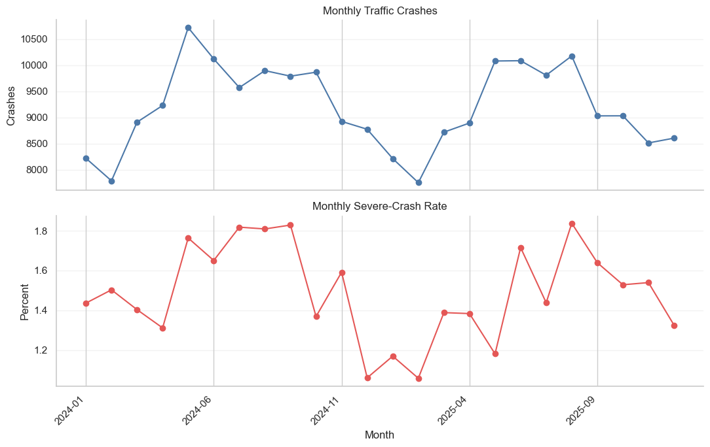
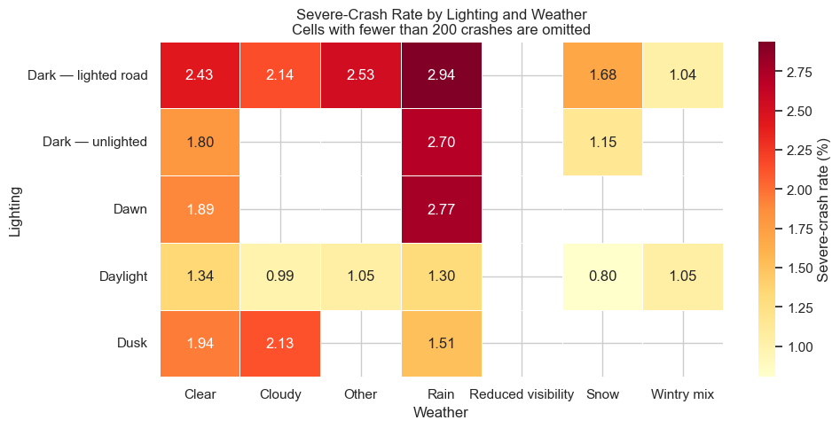
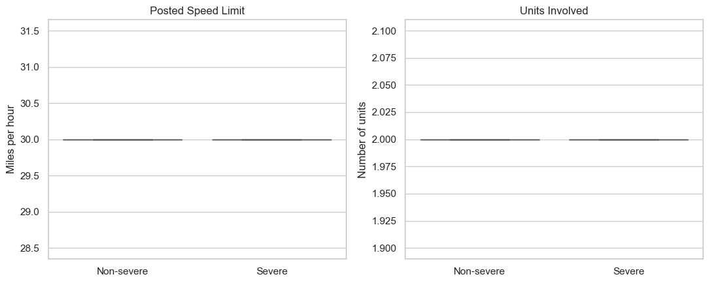
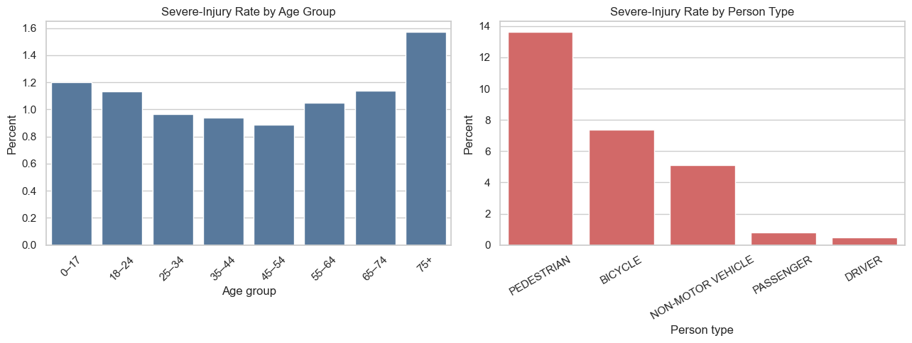

---
AIGC:
    Label: "1"
    ContentProducer: 001191440300708461136T1XGW3
    ProduceID: a00e5df06e93a5902bdea1ae35e297b8_cecaf8cdc96811f196f9525400248c00
    ReservedCode1: Tij2ycXbgrXJjzqAOHa+V1dcp+1mS2PE1lTYLVFWPmV9WnT5tAr8eVq8acyBhk4+zZ1A3B0mZHML0MM4zsZ0Nqjm0jdlkTkn/d6vPmTovx4ugJGSPIfP9QRDFud2EBFW0ODa12HfQ+ArNxELQJM/fXEQ5A+vMgDl12EwtCd0FjUhl3B7JsEy3cdTePg=
    ContentPropagator: 001191440300708461136T1XGW3
    PropagateID: a00e5df06e93a5902bdea1ae35e297b8_cecaf8cdc96811f196f9525400248c00
    ReservedCode2: Tij2ycXbgrXJjzqAOHa+V1dcp+1mS2PE1lTYLVFWPmV9WnT5tAr8eVq8acyBhk4+zZ1A3B0mZHML0MM4zsZ0Nqjm0jdlkTkn/d6vPmTovx4ugJGSPIfP9QRDFud2EBFW0ODa12HfQ+ArNxELQJM/fXEQ5A+vMgDl12EwtCd0FjUhl3B7JsEy3cdTePg=
---

# Visualizing Severe Traffic Crash Patterns in Chicago, 2024–2025

**CISC7204 Assignment 02 — Pair Project**

- **Members:** Tang I Choi (MC631517), Tan Min Fai (MC637132)
- **Region:** Chicago, Illinois, United States
- **Domain:** Transportation / Road Safety / Public Safety

## Research Question

Where and under which temporal, environmental, road-user, and demographic conditions were severe traffic crashes and injuries disproportionately represented in Chicago during 2024–2025?

A severe crash is defined as a crash whose most severe injury is **fatal or incapacitating**.

## Dataset & Source

The analysis uses three public datasets published by the City of Chicago through the **Chicago Data Portal** (Socrata Open Data API):

| Dataset | Source | API Endpoint |
|---|---|---|
| Traffic Crashes – Crashes | <https://data.cityofchicago.org/Transportation/Traffic-Crashes-Crashes/85ca-t3if> | `85ca-t3if` |
| Traffic Crashes – Vehicles | <https://data.cityofchicago.org/Transportation/Traffic-Crashes-Vehicles/68nd-jvt3> | `68nd-jvt3` |
| Traffic Crashes – People | <https://data.cityofchicago.org/Transportation/Traffic-Crashes-People/u6pd-qa9d> | `u6pd-qa9d` |

The notebook consumes the cleaned CSV files produced in Assignment 1 (`chicago_crashes_2024_2025_clean_base.csv`, `chicago_vehicles_2024_2025_clean_base.csv`, `chicago_people_2024_2025_clean_base.csv`). Only non-personal, aggregated crash attributes are used; no personal identifying information is published in this repository.

## Methods & Tools

- **Data preparation & validation**: `pandas` / `numpy` — data loading, missing-value and category audit, severity mapping, grouped aggregation of severe-crash rates.
- **Visualization**: `matplotlib` — monthly frequency/severity line plots; `seaborn` — lighting × weather heatmap and severity box plots; `plotly` — interactive weekday–hour heatmap and road-user bar chart; `folium` — geographic heat map of severe crash locations.

## Visualizations









The notebook also renders interactive Plotly heatmaps/bar charts and a Folium heat map (open the notebook to explore them).

## Key Findings

1. **Severe crashes are rare but consequential.** Of 220,709 crash records with a known severity, **3,312** were severe (fatal or incapacitating injury) — an overall severe-crash rate of **1.50%**.
2. **Temporal patterns.** The highest monthly severe-crash rate occurred in **2025-08**; the highest weekday–hour rate was **Thursday 03:00**.
3. **Road-user patterns.** **Pedestrians** had the highest severe-involvement rate among person types (**13.61%**, 889 / 6,532), followed by **bicycles** (**7.37%**, 360 / 4,888).
4. **Demographic patterns.** People aged **75+** had the highest severe-injury rate among age groups (130 / 8,285 ≈ 1.57%).
5. **Data quality.** 466 crash records (0.21%) had no recorded `most_severe_injury` and were excluded from severity-rate analyses; 3,287 severe crashes were geocoded for the spatial map.

## Limitations

- **Observational, not causal**: descriptive/exploratory analysis; no confounding control or significance testing.
- **Missing severity labels**: 466 records (≈0.2%) excluded from severity-rate analyses.
- **Reporting bias**: relies on police crash reports, which may under-report minor crashes.
- **Two-year window**: 2024–2025 only, limiting generalizability.
- **Simplified severity mapping**: "minor injury" groups non-incapacitating injuries with reported-but-not-evident cases.

## How to Reproduce

1. **Prepare the data.** The notebook reads the cleaned CSVs from the Assignment 1 data directory:
   `chicago_crashes_2024_2025_clean_base.csv`, `chicago_vehicles_2024_2025_clean_base.csv`, `chicago_people_2024_2025_clean_base.csv`.
   Adjust the `DATA_DIR` path in the first code cell if your files are stored elsewhere.

2. **Set up the environment.**
   ```bash
   python -m venv venv
   source venv/bin/activate        # macOS / Linux
   pip install -r requirements.txt
   ```

3. **Run the notebook.**
   ```bash
   jupyter notebook CISC7204-Assgn02-PairProject-Code-MC631517-MC637132.ipynb
   ```
   Execute cells top-to-bottom.

4. **Outputs.** The notebook prints summary tables and renders static figures, interactive Plotly charts, and a Folium heat map.
*（内容由AI生成，仅供参考）*
