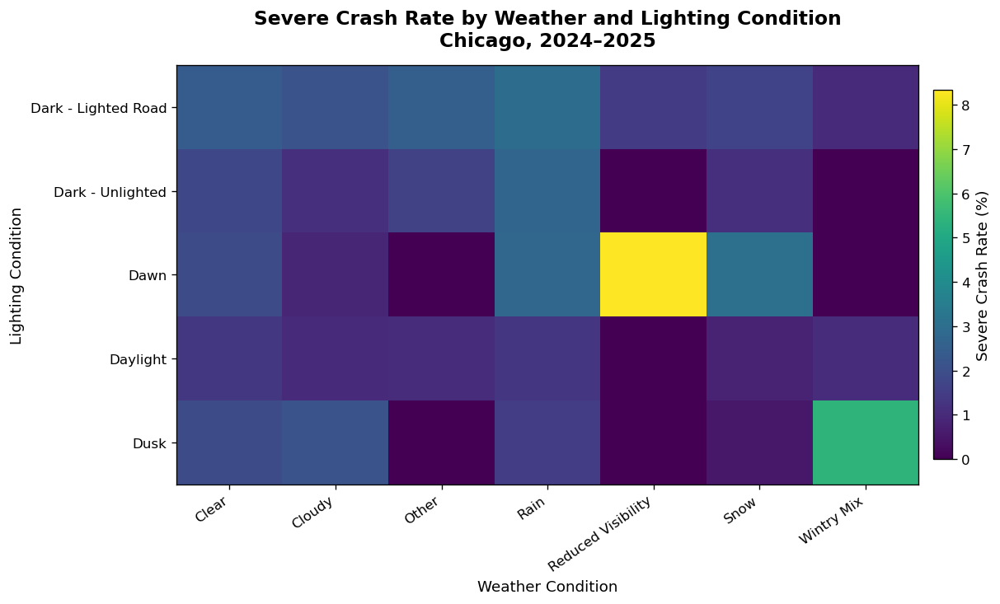
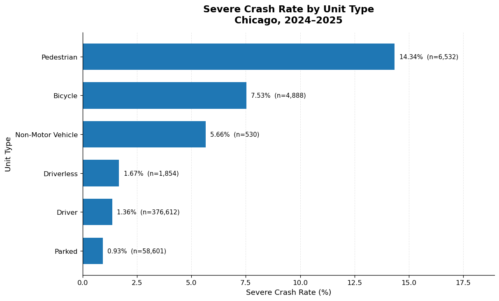

# Chicago Traffic Crash Severity Analysis (2024–2025)

A data-science exploration of traffic crash severity in Chicago across 2024 and 2025, examining how environmental conditions (weather, lighting, road surface, speed limit), time of day, vehicle type, and participant characteristics relate to severe crashes (fatal or incapacitating-injury outcomes).

## Research Question

What environmental, temporal, and demographic factors are associated with the **severity** of traffic crashes in Chicago during 2024–2025? In particular:

- How do weather, lighting conditions, road surface, and posted speed limits affect the share of crashes that end in a fatal or serious injury?
- When (weekday, month, hour) and for whom (age group, road-user type) do severe crashes occur most often?

## Dataset & Source

The analysis uses three public datasets published by the City of Chicago through the **Chicago Data Portal** (Socrata Open Data API):

| Dataset | Source (Chicago Data Portal) | API Endpoint |
|---|---|---|
| Traffic Crashes – Crashes | <https://data.cityofchicago.org/Transportation/Traffic-Crashes-Crashes/85ca-t3if> | `85ca-t3if` |
| Traffic Crashes – Vehicles | <https://data.cityofchicago.org/Transportation/Traffic-Crashes-Vehicles/68nd-jvt3> | `68nd-jvt3` |
| Traffic Crashes – People | <https://data.cityofchicago.org/Transportation/Traffic-Crashes-People/u6pd-qa9d> | `u6pd-qa9d` |

**Usage license**: The data are made publicly available by the City of Chicago under the Chicago Data Portal's open-data terms of use (see <https://data.cityofchicago.org> for the full terms). Only non-personal, aggregated crash attributes are used; no personal identifying information is published in this repository.

**Dataset coverage (2024-01-01 to 2025-12-31)**:
- `chicago_crashes_2024_2025.csv` — 221,175 crash records × 20 fields (severity, weather, lighting, road surface, speed limit, geo-coordinates, etc.)
- `chicago_vehicles_2024_2025.csv` — 450,185 vehicle-unit records × 16 fields
- `chicago_people_2024_2025.csv` — 485,110 person records × 17 fields

> **Note**: The raw CSV files exceed GitHub's file-size limits (100 MB per file) and are therefore **not** included in this repository. Download them from the Chicago Data Portal links above (or run the notebook, which downloads them automatically via the Socrata API).

## Methods & Tools

- **Data acquisition**: `requests` + Socrata Open Data API with paginated downloads (10,000 rows per page), retry logic for timeouts/connection errors.
- **Data wrangling & analysis**: `pandas` / `numpy` — data cleaning, field mapping (severity, weather, lighting, road-surface, speed-limit grouping), record linkage across crashes/vehicles/people, and group-wise aggregation (severe-crash rate per condition).
- **Visualization**: `matplotlib` — heatmaps, bar charts, and a geographic hexbin map of severe crash locations.
- **Analysis design**: descriptive/exploratory analysis comparing severe-crash rates across factor levels (weather × lighting, speed-limit bins, weekday × hour, vehicle/road-user type, age group).

Example figures produced by the notebook:






## Key Findings

1. **Severe crashes are rare but consequential.** Of 221,175 crashes recorded in 2024–2025, 196 were **fatal** and 3,116 involved a **serious (incapacitating) injury**; combined, 3,312 crashes (≈ **1.50%**) were classified as severe (Fatal or Serious Injury).

2. **Adverse environmental conditions raise severe-crash rates.** Rainy conditions had the highest severe-crash rate among weather types (**1.97%**, 311 / 15,763) versus 1.60% in clear weather; crashes on **dark but lighted roads** showed the highest lighting-related rate (**2.37%**, 1,103 / 46,518); wet road surfaces reached **1.84%** (436 / 23,638). Posted speed limits of **36–40 mph** were associated with the highest severe rate (**3.72%**, 83 / 2,230).

3. **Vulnerable road users face the highest risk.** Crashes involving **pedestrians** were severe in **14.34%** of cases (937 / 6,532) and **bicycles** in **7.53%** (368 / 4,888); motorcycles were involved in severe crashes **13.39%** of the time (207 / 1,546). By age, people **75+** had the highest severe-injury rate (**1.57%**, 130 / 8,285).

4. **Time patterns.** Sundays had the highest severe-crash rate by weekday (**2.01%**, 561 / 28,024); late-night hours (2–3 a.m.) peaked at ≈ **3.1%**; August showed the highest monthly rate (**1.82%**, 366 / 20,116).

## Limitations

- **Missing severity labels**: 466 crash records (≈0.2%) had no recorded `most_severe_injury` and were excluded from the severity-rate analyses.
- **Observational, not causal**: The analysis is descriptive; it does not control for confounding factors or perform statistical significance testing, so associations should not be read as causal effects.
- **Reporting bias**: The data rely on police crash reports, which may under-report minor crashes or omit some details.
- **Limited time window**: Only two years (2024–2025) are covered, limiting generalizability and trend analysis.
- **Simplified severity mapping**: "Minor injury" groups together non-incapacitating injuries and reported-but-not-evident cases, which may blur fine-grained distinctions.

## How to Reproduce

1. **Get the data.** The raw CSVs are not shipped in this repository because they exceed GitHub's 100 MB per-file limit. Download the three files from the Chicago Data Portal (see links above):
   - `chicago_crashes_2024_2025.csv`
   - `chicago_vehicles_2024_2025.csv`
   - `chicago_people_2024_2025.csv`

   Alternatively, run the first three notebook cells, which download the datasets automatically via the Socrata Open Data API (requires internet access; paginated requests may take several minutes).

2. **Set up the environment.**
   ```bash
   python -m venv venv
   source venv/bin/activate        # macOS / Linux
   pip install -r requirements.txt
   ```

3. **Run the notebook.**
   ```bash
   jupyter notebook Chicago_Traffic_Crash_Severity_Analysis.ipynb
   ```
   Execute the cells top-to-bottom. The analysis assumes the three CSV files are located in the same directory as the notebook (the download cells save them there automatically).

4. **Outputs.** The notebook prints summary tables and saves the figures shown above (SVG/PNG).
